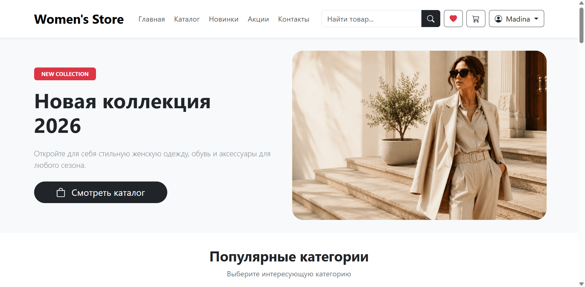
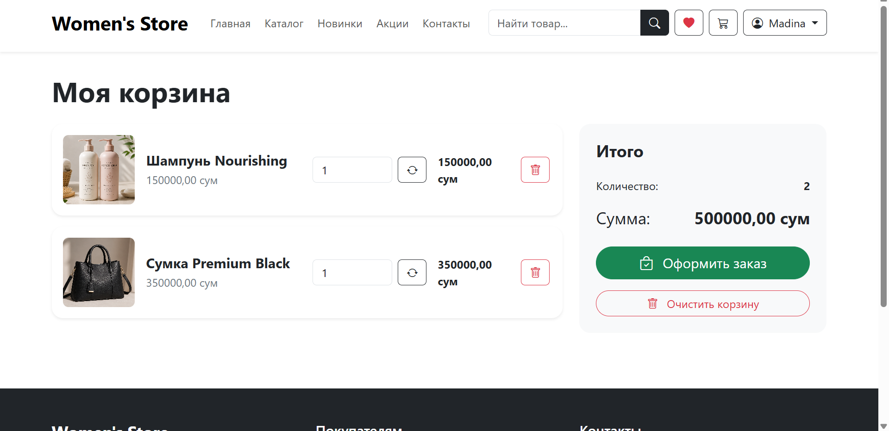

# 🛍️ Women's Store

Интернет-магазин женской одежды, обуви, аксессуаров, косметики и товаров для ухода, разработанный на Django.

🌐 **Демо:** https://womens-store-django.onrender.com

> Сайт размещён на бесплатном тарифе Render, поэтому первая загрузка может занять до минуты.

## 📸 Скриншоты

| Главная страница | Категории |
|---|---|
|  |  |

| Каталог товаров | Корзина |
|---|---|
|  |  |

## ✨ Возможности

- Регистрация и авторизация пользователей
- Категории и каталог товаров, метки «Новинка» и «Акция»
- Поиск товаров по названию
- Подробная страница товара с наличием на складе
- Корзина: добавление, изменение количества, удаление
- Избранное
- Отзывы и рейтинг товаров
- Оформление заказа с выбором способа оплаты
- История заказов пользователя
- REST API для товаров и категорий с JWT-авторизацией
- Управление товарами и заказами через Django Admin

## 🛠️ Технологии

**Backend:** Python, Django, Django REST Framework, Simple JWT
**Frontend:** HTML5, CSS3, Bootstrap 5, JavaScript
**База данных:** PostgreSQL (Supabase), SQLite для локальной разработки
**Хранение изображений:** Supabase Storage (S3, django-storages)
**Деплой:** Render, Gunicorn, WhiteNoise

## 📂 Приложения проекта

- `products` — категории, товары, поиск, отзывы и API
- `cart` — корзина пользователя
- `favorites` — избранные товары
- `orders` — оформление и история заказов
- `users` — регистрация и авторизация

## 🔌 API

| Метод | Адрес | Описание |
|---|---|---|
| GET | `/api/products/` | Список товаров |
| GET | `/api/products/<id>/` | Один товар |
| GET | `/api/categories/` | Список категорий |
| GET | `/api/categories/<id>/` | Одна категория |
| POST | `/api/token/` | Получить JWT-токен |
| POST | `/api/token/refresh/` | Обновить токен |

## 🚀 Установка и запуск

```bash
git clone https://github.com/Khudoyorova/womens-store-django.git
cd womens-store-django

python -m venv .venv
.venv\Scripts\activate        # Windows
# source .venv/bin/activate   # macOS / Linux

pip install -r requirements.txt
```

Создайте файл `.env` в корне проекта:

```env
DJANGO_SECRET_KEY=ваш-секретный-ключ
DEBUG=True
ALLOWED_HOSTS=127.0.0.1,localhost
```

Без `DATABASE_URL` используется SQLite, без `AWS_STORAGE_BUCKET_NAME` изображения сохраняются локально в `media/`.

```bash
python manage.py migrate
python manage.py loaddata products_data.json
python manage.py createsuperuser
python manage.py runserver
```

Сайт откроется на http://127.0.0.1:8000

## 👩‍💻 Автор

**Maftuna Khudoyorova** — [GitHub](https://github.com/Khudoyorova)